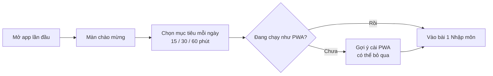
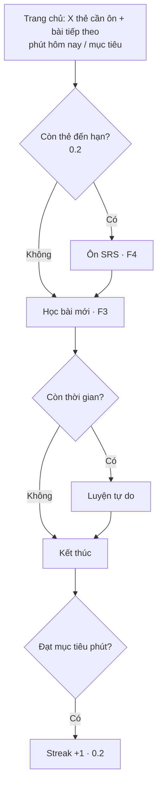
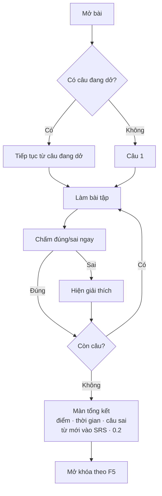
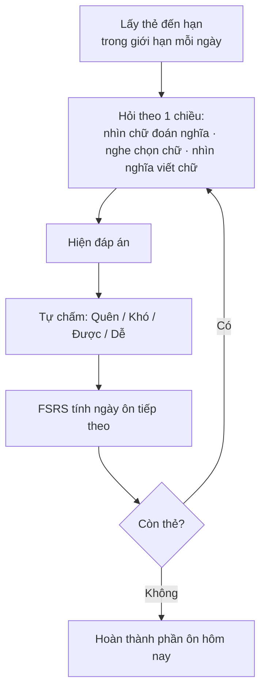
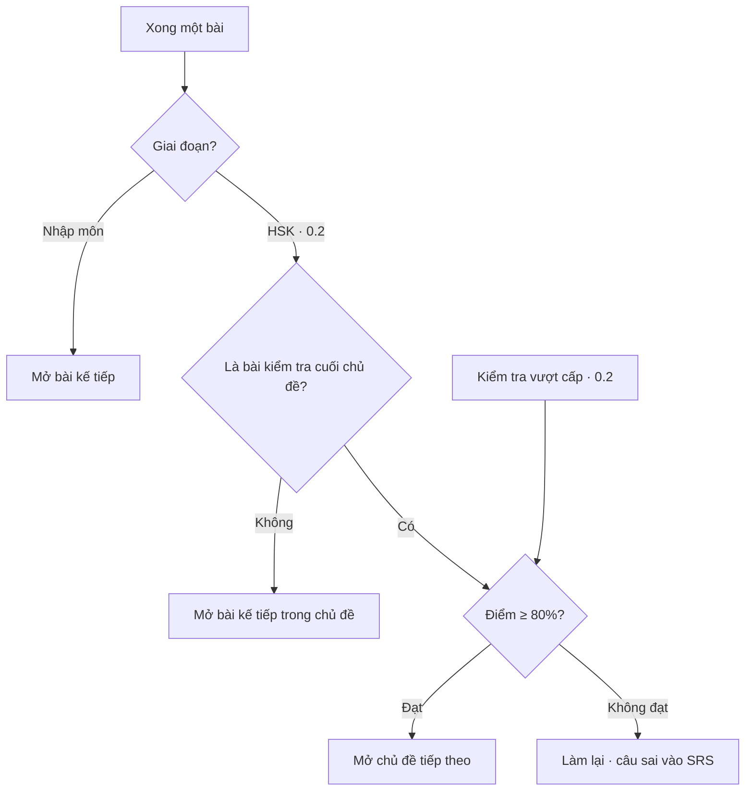
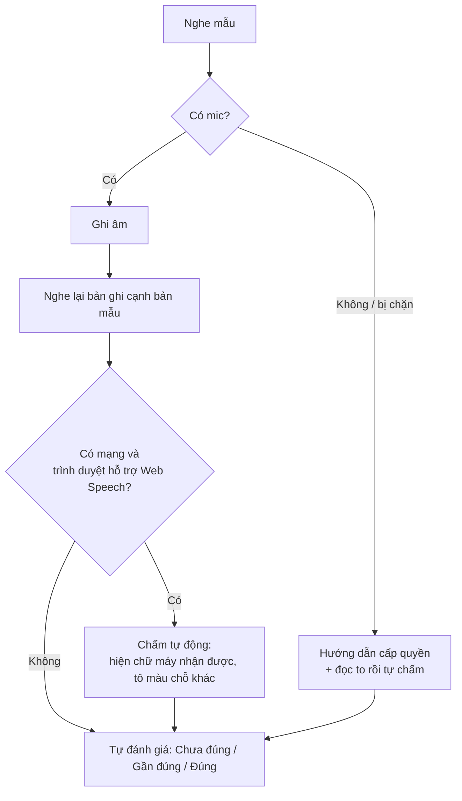
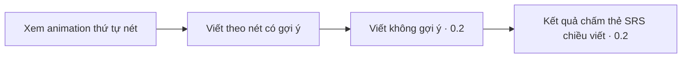

# 02 · Design: Business flow

> Trạng thái: **Đã chốt** · Ngày: 2026-10-27
> Liên quan: [Roadmap](roadmap.md) · [Epic & story](epics-stories.md)

Mỗi luồng ghi rõ bản phát hành nó xuất hiện. Phần nào chỉ có từ 0.2 thì được đánh dấu **(0.2)**.

---

## F1. Mở app lần đầu (0.1)

Không có bài test xếp lớp, vì app dành cho người bắt đầu từ số 0.



Quy tắc:
- Onboarding chỉ hiện ở lần mở đầu tiên. Mục tiêu phút đổi lại được trong Cài đặt.

## F2. Buổi học mỗi ngày (0.1, phần SRS và streak từ 0.2)



Quy tắc:
- Phần ôn SRS làm trước bài mới.
- Streak tăng 1 khi số phút học trong ngày đạt mục tiêu **(0.2)**.

## F3. Chạy một bài học (0.1)



Quy tắc:
- Mỗi câu chấm ngay sau khi trả lời. Trả lời sai thì có giải thích.
- Thoát giữa chừng thì vị trí câu đang làm được lưu lại, lần sau mở bài sẽ học tiếp từ câu đó.

## F4. Ôn SRS (0.2)



Quy tắc:
- Giới hạn mỗi ngày: tối đa **20 thẻ mới** và **200 lượt ôn**, chỉnh được trong Cài đặt.
- Thẻ chiều "viết" chỉ được tạo sau khi từ đó đã được viết theo nét ít nhất 1 lần.

## F5. Mở khóa (0.1, phần chủ đề từ 0.2)



Quy tắc:
- **Nhập môn:** học xong bài trước thì mở bài sau.
- **HSK** **(0.2)**:
  - Các bài trong một chủ đề mở lần lượt.
  - Bài kiểm tra cuối chủ đề đạt từ 80% trở lên thì mở chủ đề tiếp theo.
  - Các câu làm sai được đưa vào SRS.
- **Kiểm tra vượt cấp (0.2):** người học có thể làm bài kiểm tra của một chủ đề chưa mở để bỏ qua nó. Ngưỡng đạt vẫn là 80%.

## F6. Luyện nói (0.1)



Quy tắc:
- Bản ghi âm chỉ giữ trong bộ nhớ khi đang làm bài, không lưu lại.

## F7. Luyện viết (0.1, phần không gợi ý từ 0.2)



Quy tắc:
- Khi viết theo nét: viết sai nét thì báo ngay, sai 3 lần liên tiếp thì hiện gợi ý.

## F8. Offline & dữ liệu (0.1, phần tải và export/import từ 0.2)

```mermaid
flowchart TD
  subgraph Offline
    A[Cài app] --> B[Tự lưu khung app, nội dung,<br/>audio Nhập môn]
    C[Chọn chủ đề HSK · 0.2] --> D[Tải audio về<br/>hiện dung lượng · xóa được]
  end
  subgraph Sao lưu · 0.2
    E[Export] --> F[File JSON tiến độ]
    F --> G[Import ở máy khác]
    G --> H{File hợp lệ?}
    H -- Không --> I[Báo lỗi, giữ nguyên dữ liệu cũ]
    H -- Có --> J[Hỏi xác nhận ghi đè]
    J -- Đồng ý --> K[Ghi đè toàn bộ tiến độ]
  end
```

Quy tắc:
- Import thì **ghi đè** toàn bộ dữ liệu, không gộp với dữ liệu đang có. Luôn hỏi xác nhận trước khi ghi đè.
