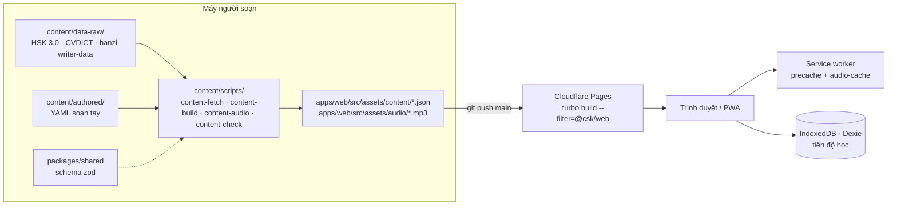

# 03 · Architecture

> Trạng thái: **Đã chốt** · Ngày: 2026-10-27 · Cập nhật: 2026-11-02 (chuyển sang monorepo)
> Liên quan: [Brainstorm](01-brainstorm.md) · [Roadmap](02-design/roadmap.md) · [Epic & story](02-design/epics-stories.md)

## 1. Tổng quan

- **Monorepo** (pnpm workspaces + Turborepo): app, schema dùng chung, pipeline nội dung và tài liệu nằm chung một repo. Khi có backend (bản 1.0) chỉ cần thêm `apps/api`, spec vẫn ở `docs/` chung.
- **PWA tĩnh, local-first**: toàn bộ app là file tĩnh, tiến độ học lưu trong IndexedDB trên máy.
- **Bản 0.1 và 0.2 không có backend.**
- Nội dung (JSON) và audio (mp3) được một **pipeline** tạo ra trên máy của người soạn, rồi commit vào repo. Cloudflare Pages chỉ build phần app.
- Lớp lưu trữ `ProgressStore` được tách riêng. Đến bản 1.0 chỉ cần thay bằng bản có đồng bộ (ứng viên: Supabase), không phải viết lại app.



## 2. Tech stack

| Lớp | Lựa chọn | Ghi chú |
|---|---|---|
| App | **React 19 + Vite 6 + TypeScript**, React Router 7 | Router dùng qua lớp `custom-router-dom` của boilerplate |
| Package manager | **pnpm** workspaces | Theo boilerplate. Version thư viện khai báo một lần bằng **pnpm catalog** trong `pnpm-workspace.yaml`, các package dùng `catalog:` |
| Monorepo | **Turborepo** | Chạy task theo package, có cache và `--affected`. Không dùng Nx (quá nặng cho một app), không dùng Changesets (không publish package) |
| Giao diện | **Tailwind CSS** | Thay cho SCSS global của boilerplate (bỏ `src/stylesheet/` và sass) |
| PWA | **vite-plugin-pwa** (Workbox) | Manifest, service worker, chiến lược cache, báo bản cập nhật |
| Lưu trữ | **Dexie** + `dexie-react-hooks` | Dữ liệu trong IndexedDB đổi thì giao diện tự cập nhật, không cần thêm thư viện quản lý state |
| SRS | **ts-fsrs** | Thư viện FSRS chính thức cho TypeScript |
| Viết chữ | **hanzi-writer** + hanzi-writer-data | Animation nét, chấm từng nét |
| Pinyin | **pinyin-pro** (chỉ dùng trong pipeline, để đối chiếu) + `pinyin.utils.ts` tự viết | Tự viết phần đổi `ni3` → `nǐ` và so sánh pinyin, để kiểm soát và test được |
| Nói | **MediaRecorder** (ghi âm) + **Web Speech API** `zh-CN` (chấm) | Chấm tự động chỉ chạy trên Chrome/Safari khi có mạng |
| TTS | **edge-tts** (Python CLI) | Giọng `zh-CN-XiaoxiaoNeural` (nữ) và `zh-CN-YunxiNeural` (nam). Nằm ngoài pnpm, cài bằng `uv tool install edge-tts`; `audio-gen` kiểm tra lệnh có sẵn chưa, chưa có thì báo lỗi kèm hướng dẫn cài |
| i18n | **i18next** + react-i18next | Hiện chỉ có `vi` |
| Pipeline | Script **Node/TS** chạy bằng `tsx` + **zod** | Package `@csk/content`, import schema từ `@csk/shared` |
| TypeScript | `tsconfig.base.json` ở gốc, mỗi package `extends` | Không dùng project references |
| Test | **Vitest** (`projects` ở `vitest.config.ts` gốc: jsdom cho web, node cho shared và content) + Testing Library + **fake-indexeddb**; **Playwright** cho e2e | Một lệnh `pnpm test:run` chạy toàn repo |
| Lint/format | ESLint (một flat config ở gốc) + Prettier | Theo boilerplate, `--max-warnings 0` cho toàn repo |
| Hosting | **GitHub** + **Cloudflare Pages** | Tự build khi push `main`, có HTTPS (PWA bắt buộc). Root directory là gốc repo, build `pnpm turbo run build --filter=@csk/web`, output `apps/web/dist`, biến môi trường `NODE_VERSION=24.22.1` và `PNPM_VERSION=10.26.2` (khớp `packageManager`), production branch `main`. `apps/web/src/assets/_headers` đặt `no-cache` cho `sw.js`, `index.html`, manifest để banner cập nhật hoạt động |

## 3. Cấu trúc thư mục

### 3.1 Monorepo

| Package | Tên | Vai trò |
|---|---|---|
| `apps/web` | `@csk/web` | PWA |
| `packages/shared` | `@csk/shared` | Schema zod và logic thuần dùng chung: `content.schema`, `progress.schema` (cũng dùng cho file backup và đồng bộ sau này), `pinyin.utils` |
| `content` | `@csk/content` | Pipeline nội dung: nguồn dữ liệu, YAML soạn tay, script build/check/audio |
| `apps/api` | `@csk/api` | **Bản 1.0.** Supabase (`supabase/`: migration, RLS, edge function) hoặc Hono trên Cloudflare Workers. Chưa tạo |

**Quy tắc phụ thuộc:** chỉ một chiều `web → shared ← content` (sau này thêm `api → shared`). `shared` không import ngược lại package nào, không import React hay Dexie.

**Package nội bộ không build:** `packages/shared` khai báo `exports` trỏ thẳng vào `src/index.ts`. Vite, Vitest và tsx đọc trực tiếp source TS.

**Import chéo package** dùng tên package (`import { lessonSchema } from '@csk/shared'`), không dùng alias. `aliases.ts` của boilerplate chỉ dùng **bên trong** `apps/web`.

### 3.2 Cây thư mục

Các thư mục đánh dấu *(khi cần)* chỉ tạo khi bắt đầu dùng tới.

```
chinese-starter-kit/
├── package.json  pnpm-workspace.yaml  pnpm-lock.yaml  turbo.json
├── tsconfig.base.json  eslint.config.mjs  vitest.config.ts  .prettierrc  .editorconfig
├── CLAUDE.md                                  # bối cảnh chung, sơ đồ repo, lệnh chạy
├── .mcp.json                                  # (khi cần) MCP dùng chung
├── .claude/
│   ├── settings.json                          # permission + hook dùng chung
│   ├── rules/                                 # rule theo đuôi file: typescript, react, styles
│   ├── skills/  commands/                     # openspec-* và /opsx:* (sinh bởi `openspec init`), frontend, content-authoring…
│   ├── agents/                                # (khi cần) test-writer, implementer, reviewer…
│   └── hooks/                                 # (khi cần) lint/typecheck sau khi sửa, chạy test trước khi xong
├── openspec/                                  # config.yaml, specs/ (hành vi đã giao), changes/ (đang làm, archive/)
├── .github/workflows/ci-workflow.yml          # openspec validate · typecheck lint test:run content:check · build + check:fonts
├── docs/                                      # tài liệu chung cho mọi package
│   ├── 01-brainstorm.md  02-design/  03-architecture.md
│   ├── 04-specs/                              # spec chi tiết theo epic, AC ghi phạm vi [web] [api] [contract]
│   ├── 05-standards/                          # tài liệu standard gốc, .claude/rules trỏ tới
│   ├── 06-ai-practice/                        # kế hoạch luyện level, effort log, retro
│   └── plans/  decisions/                     # (khi cần) plan theo story, ADR ngắn
├── scripts/                                   # (khi cần) script cấp repo, ví dụ ac-coverage.ts
│
├── packages/shared/                           # @csk/shared
│   ├── package.json  tsconfig.json
│   └── src/
│       ├── index.ts
│       ├── content.schema.ts                  # Stage, Unit, Lesson, Exercise (theo kind), Word, Sentence…
│       ├── progress.schema.ts                 # LessonProgress, Card, Settings, Snapshot (schemaVersion)
│       └── pinyin.utils.ts                    # đổi ni3 → nǐ, so sánh pinyin (+ *.test.ts cạnh file)
│
├── content/                                   # @csk/content
│   ├── package.json  tsconfig.json
│   ├── authored/                              # soạn tay: path.yaml (lộ trình), lessons/**/*.yaml, vi-meanings.yaml, tts-overrides.yaml
│   ├── data-raw/                              # bản đã lọc của nguồn mở (hsk1.words.json, cvdict.hsk1.json) + README nguồn/license;
│   │                                          # file gốc ở .cache/ (không commit), fonts/ (TTF không commit, font:subset tự tải)
│   └── scripts/                               # content-fetch → content-build → content-audio → font-subset; content-check
│                                              # output ghi vào apps/web/src/assets/{content,audio,fonts}
│
└── apps/web/                                  # @csk/web
    ├── package.json  CLAUDE.md                # CLAUDE.md riêng: quy ước frontend
    ├── aliases.ts  tsconfig.json  vite.config.ts  playwright.config.ts
    ├── e2e/                                   # Playwright, chia theo epic: E1/s1.2-offline.spec.ts…
    └── src/                                   # Vite root, publicDir = assets
    ├── index.html  index.css               # index.css nạp styles/tailwind/main.css
    ├── styles/tailwind/                    # design system: tokens/ (màu, spacing, chữ), base/ (font, nền), themes/_dark.css
    ├── assets/
    │   ├── i18n/vi/{common,home,learning-path,lesson,review,settings}.json
    │   ├── icons/  images/
    │   ├── fonts/                          # ← LXGW WenKai đã cắt (content: font:subset)
    │   ├── content/                        # ← output JSON của pipeline
    │   └── audio/                          # ← output mp3 của pipeline
    ├── config/environment.ts
    ├── test/
    │   ├── setup.ts                        # jest-dom, cleanup, fake-indexeddb, xóa DB sau mỗi test
    │   ├── render.tsx                      # renderWithProviders: i18n → SettingsProvider → MemoryRouter
    │   ├── factories.ts                    # makeWord, makeSentence, makeLesson, makeExercise(kind), makeCard, makeLessonProgress…
    │   └── i18n.ts                         # instance i18n cho test, nạp vi/*.json thật
    └── app/
        ├── App.tsx  app.routes.ts  AppErrorBoundaryFallback.tsx  AppSuspense.tsx
        ├── core/
        │   ├── constants/                  # DB_NAME, giới hạn mỗi ngày, ngưỡng mở khóa 80%…
        │   ├── helpers/db.helper.ts        # khai báo schema và migration Dexie
        │   ├── hooks/                      # useAudioPlayer, useRecorder, useOnlineStatus
        │   ├── modules/
        │   │   ├── custom-router-dom/      # giữ từ boilerplate, bỏ PrivateRoute
        │   │   └── pwa/                    # đăng ký service worker, banner "Có bản mới"
        │   └── services/
        │       ├── i18n.service.ts
        │       ├── progress-store.service.ts   # interface ProgressStore + DexieProgressStore
        │       ├── audio.service.ts            # phát audio, ghi âm
        │       └── speech.service.ts           # adapter Web Speech
        ├── pages/
        │   ├── Page.tsx  page.routes.ts    # khung app: header + <Outlet/> + thanh điều hướng dưới
        │   └── onboarding/ home/ learning-path/ lesson/ review/ practice/ dictionary/ settings/ error/
        │       └── (mỗi feature) <feature>.routes.ts · containers/ · components/ · hooks/
        └── shared/
            ├── components/
            │   ├── common/  layout/  partials/
            │   └── exercises/              # mỗi dạng bài tập 1 component + exercise.registry.ts
            ├── contexts/settings.context.tsx   # bật/tắt pinyin, tốc độ audio…
            ├── models/                     # type riêng của UI; schema nội dung và tiến độ lấy từ @csk/shared
            ├── services/                   # content · srs · progress · backup (.service.ts)
            └── utils/                      # date.utils.ts
```

### 3.3 Từ boilerplate sang

Theo boilerplate [`b-react-vite-ts`](/Users/trang.nguyen/Documents/projects/b-react-vite-ts).

- **Copy vào `apps/web`:** `aliases.ts`, `tsconfig.json`, `vite.config.ts` (root = `src`, `publicDir: 'assets'`, entry `/app/App.tsx`), `.claude/skills/frontend` (chuyển lên `.claude/skills/` ở gốc, sửa đường dẫn).
- **Đưa lên gốc repo:** `eslint.config.mjs`, `.prettierrc`, `.prettierignore`, `.editorconfig`, `vitest.config.ts` (đổi sang `projects`), `.github/workflows/ci-workflow.yml` (đổi sang turbo), `CLAUDE.md` (tách phần chung lên gốc, phần frontend để ở `apps/web/CLAUDE.md`).
- **Bỏ:** `core/auth`, axios `api.service`, `config/endpoint.ts`, `PrivateRoute`, `auth.context`, các file mẫu article, `src/stylesheet/` và sass.

## 4. Module & trách nhiệm

Đường dẫn trong bảng: `core/`, `shared/`, `pages/` là thư mục trong `apps/web/src/app/`.

| Module | Trách nhiệm | Epic |
|---|---|---|
| `content/` (`@csk/content`) | Ghép dữ liệu mở với bài soạn tay thành JSON, kiểm tra schema và độ phủ từ, tạo mp3, lọc dữ liệu nét chữ | E2, E7, E11 |
| `packages/shared` (`@csk/shared`) | Schema zod của nội dung và tiến độ, `pinyin.utils` (đổi số → dấu, so sánh pinyin) | E2, E4, E8, E10 |
| `core/modules/pwa` + cấu hình vite-plugin-pwa | Manifest, service worker, cache, banner cập nhật | E1, E8 |
| `core/services/progress-store` + `core/helpers/db.helper` | Nơi duy nhất đọc/ghi IndexedDB | E3, E8, E9 |
| `core/services/audio`, `core/services/speech`, `core/hooks/*` | Phát audio, ghi âm, chấm Web Speech, trạng thái online | E4, E5, E10 |
| `shared/services/content.service` | Nạp JSON nội dung, tra từ và câu theo ID, tìm kiếm từ điển | E3, E10 |
| `shared/services/progress.service` | Quy tắc mở khóa, chấm điểm bài, cursor học dở, phút học mỗi ngày, streak | E3, E8 |
| `shared/services/srs.service` | Bọc ts-fsrs: tạo thẻ, chấm, lấy thẻ đến hạn trong giới hạn mỗi ngày, thống kê | E9 |
| `shared/services/backup.service` | Export/import, kiểm tra file trước khi ghi đè | E8 |
| `shared/components/exercises` | Các dạng bài tập + registry theo `kind` | E4, E5, E6, E10 |
| `pages/*` | Màn hình: onboarding, home, learning-path, lesson, review, practice, dictionary, settings | E1, E3, E8, E9, E10 |

## 5. Pattern (theo boilerplate)

- **Luồng dữ liệu:** `container → pages/<feature>/hooks/use… → shared/services → core/services`.
  - Ví dụ: `useLessonRunner` gọi `ProgressService` để lưu cursor và chấm điểm, gọi `SrsService` để tạo thẻ.
- **Service dạng class:**
  - Các service trong `shared/services` giữ một instance `ProgressStore`, giống cách `ArticleService` giữ `ApiService` trong boilerplate.
  - Mỗi service gồm 3 lớp: truy cập dữ liệu (private), quy tắc nghiệp vụ thuần (public, không đụng vào store), use-case điều phối.
  - Service không import React hay router.
- **Component bài tập** chỉ nhận dữ liệu qua props (`exercise`, `onResult`, `isLocked`). Audio và ghi âm lấy qua hook trong `core/hooks`, không import service trực tiếp.
- **Route:** mỗi feature export `PageRoute[]` (container lazy-load) từ `<feature>.routes.ts`, gom về `pages/page.routes.ts` rồi về `app.routes.ts`.
  - URL theo RESTful: danh từ tài nguyên, kebab-case, collection số nhiều, tên cụ thể (`/learning-paths`, `/lessons/:lessonId`). `ROUTE_PATHS` trong `core/constants/app.constants.ts` là nguồn duy nhất của URL.
- **i18n:** chuỗi giao diện đặt trong `apps/web/src/assets/i18n/vi/<namespace>.json`, dùng `useTranslation(namespace)`. Nội dung bài học không nằm trong i18n mà nằm trong JSON của pipeline.
- **Alias:** trong `apps/web`, `aliases.ts` là nguồn duy nhất, giữ đồng bộ với `apps/web/tsconfig.json`. Sang package khác thì import bằng tên package (xem 3.1).

## 6. Mô hình dữ liệu

### 6.1 Nội dung (JSON tĩnh, chỉ đọc)

```ts
Stage   { id, title, units: Unit[] }
Unit    { id, title, lessonIds: LessonId[] }    // Nhập môn = 1 unit gồm 12 bài
Lesson  { id, type, title, exercises: Exercise[] }
Exercise = union phân biệt theo `kind`:
  tone-choice | sound-pair | pinyin-type | speak | stroke-write |
  flashcard | listen-choose | meaning-choose | reorder | fill-blank |
  grammar-card | dialogue | roleplay | reading
  // bài tập tham chiếu tới Word/Sentence bằng ID
Word        { id, hanzi, pinyin, vi: string[], viReviewed, hsk, audio }  // id = hanzi; chữ đa âm: `hanzi:pinyin`
Sentence    { id, hanzi, pinyin, vi, audio, voice }
GrammarPoint{ id, title, explanationVi, pattern, examples: SentenceId[] }
// file gốc có `contentVersion`
```

File output (`apps/web/src/assets/content/`): `content.json` (`contentVersion` + `stages`), `words.json`,
`sentences.json`, `lessons/<id>.json`, `strokes/<chữ>.json` (hanzi-writer, chỉ chữ có trong bài).
Audio: `apps/web/src/assets/audio/<hash>.mp3`, hash của giọng + chữ được đọc.

**Lệnh pipeline** (`pnpm --filter @csk/content …`):

| Lệnh | Việc | Cần mạng |
|---|---|---|
| `content:fetch` | Tải nguồn ghim SHA-256 (HSK 3.0, CVDICT), lọc vào `data-raw/*.json`, thêm từ mới vào `vi-meanings.yaml` | Có (lần đầu) |
| `content:build` | Ghép nguồn + YAML soạn tay thành JSON, chép nét chữ; có lỗi thì không ghi | Không |
| `content:audio` | Tạo mp3 còn thiếu bằng edge-tts (`msedge-tts`), xoá mp3 không còn dùng | Có |
| `font:subset` | Cắt font chữ Hán theo nội dung | Có (lần đầu) |
| `content:check` | Kiểm tra (S2.1–S2.5) + output khớp nguồn; chạy trong CI | Không |

Cấu trúc `Stage → Unit → Lesson` dùng chung cho Nhập môn và mọi cấp HSK.

### 6.2 Dữ liệu người dùng (các bảng Dexie)

| Bảng | Khóa | Nội dung |
|---|---|---|
| `settings` | key | Mục tiêu phút, tốc độ audio, hiện pinyin, giới hạn SRS, đã xong onboarding… |
| `lessonProgress` | `lessonId` | `status`, `bestScore`, `cursor` (vị trí câu đang dở) |
| `cards` | `"wordId:facet"` | Trạng thái FSRS, `due` (có index) |
| `reviewLogs` | auto | `cardId`, `rating`, `reviewedAt`… |
| `dailyStats` | `date` | `minutes`, `reviews`, `newCards`, dùng để tính streak |

**Bản ghi âm không được lưu.**

### 6.3 Interface

```ts
interface ProgressStore {
  getLessonProgress(lessonId): Promise<LessonProgress | undefined>;
  saveLessonProgress(progress): Promise<void>;
  getDueCards(now, limit): Promise<Card[]>;
  upsertCard(card): Promise<void>;
  logReview(log): Promise<void>;
  addMinutes(date, minutes): Promise<void>;
  getSettings(): Promise<Settings>;
  saveSettings(settings): Promise<void>;
  exportAll(): Promise<Snapshot>;      // có schemaVersion
  importAll(snapshot): Promise<void>;  // ghi đè toàn bộ
}

type ExerciseProps<K extends ExerciseKind> = {
  exercise: Extract<Exercise, { kind: K }>;
  onResult: (result: ExerciseResult) => void;
  isLocked: boolean; // true sau khi chấm: khóa đáp án
};
```

Lesson runner, màn ôn tập và màn luyện tự do chỉ làm việc qua `exercise.registry.ts` (map từ `kind` sang component), không cần biết bên trong từng dạng bài.

- `ExerciseResult = { isCorrect: boolean; explanation?: string }`. Component dạng bài tự soạn `explanation` từ từ/câu của nó; runner chỉ hiện khi trả lời sai (`LessonService.shouldShowExplanation`).
- `exerciseRegistry` là `Partial<Record<kind, component>>`, rỗng cho tới khi E4–E6 đăng ký. `kind` chưa đăng ký thì runner hiện "Dạng bài này chưa có" kèm nút bỏ qua.
- `LessonService` (`shared/services`) giữ quy tắc phiên làm bài (`LessonSession`: câu hiện tại, pha `answering`/`feedback`/`finished`); `useLessonRunner` chỉ giữ state và gọi service.
- Vòng đời bài: làm hết câu thì `useLessonRunner` gọi `LessonService.finishLesson`, đặt `lessonProgress.status` thành `completed` (bài đã `completed` không bị hạ về `in-progress` khi học lại). Màn tổng kết lấy số liệu từ `LessonService.summarize(session, lessonType)` (điểm %, đúng/đã trả lời, thời gian, số câu sai, số câu bỏ qua, `isPassed`: `null` với bài thường, đạt/chưa đạt với bài kiểm tra).
- Ghi tiến độ lỗi không chặn tổng kết: `finishLesson` trả `isSaved: false`, màn tổng kết hiện cảnh báo `role="alert"` rằng kết quả chưa được lưu.
- Bài kiểm tra cuối chủ đề: `Lesson.type: 'test'`. Đạt khi điểm ≥ `TEST_PASS_PERCENT` (80%, `core/constants/lesson.constants.ts`), quy tắc nằm ở `LessonService.isTestPassed`. Bài kiểm tra luôn bắt đầu từ câu 1 và không lưu vị trí (`cursor`); màn tổng kết có nút "Làm lại".
- `WrongAnswerSink` là cổng chuyển câu sai của bài kiểm tra sang ôn tập. Bản mặc định là no-op, S9.4 thay bằng bản thật; `LessonService.finishLesson` là nơi gọi cổng; `useLessonRunner` không biết cổng và phía sau nó.

## 7. PWA & cache

| Tài nguyên | Chiến lược |
|---|---|
| Khung app (JS/CSS/HTML), toàn bộ JSON nội dung, dữ liệu nét chữ đang dùng, audio Nhập môn | **Precache** khi cài, nên bản 0.1 học offline được hoàn toàn |
| Audio HSK | **Cache-first** trong `audio-cache`. Nút "Tải chủ đề" (S8.4) nạp sẵn audio của chủ đề vào cache này; xóa thì xóa khỏi cache |
| Cập nhật app | Service worker chế độ **prompt**: hiện banner, người học bấm mới tải lại (S1.4) |
| Dữ liệu IndexedDB | Gọi `navigator.storage.persist()` để trình duyệt không tự xóa |

## 8. Xử lý lỗi

| Tình huống | Cách xử lý |
|---|---|
| Audio không tải được | Hiện nút thử lại. Pinyin vẫn hiển thị nên vẫn làm được bài |
| Mic bị chặn hoặc không có mic | Hướng dẫn cấp quyền, chuyển sang "đọc to rồi tự chấm" (S5.4) |
| Trình duyệt không có Web Speech hoặc đang offline | Ẩn phần chấm tự động (S5.3) |
| Hết dung lượng lưu trữ | Hiện thông báo, gợi ý xóa audio đã tải |
| Đổi cấu trúc IndexedDB | Migration theo version của Dexie trong `db.helper.ts` |
| File import lỗi | Kiểm tra bằng zod và `schemaVersion` **trước khi** ghi đè. Lỗi thì không đụng vào dữ liệu hiện tại (S8.5) |
| Lỗi render không lường trước | `AppErrorBoundaryFallback` của boilerplate |

## 9. Test

| Loại | Công cụ | Phạm vi |
|---|---|---|
| Unit | Vitest | `@csk/shared` (`pinyin.utils`, schema), `srs.service`, `progress.service` (mở khóa, chấm điểm, streak), `backup.service` (validate import/export), validator của pipeline |
| Store | Vitest + fake-indexeddb | `DexieProgressStore`, migration |
| Component | Vitest + Testing Library | Mỗi dạng bài tập, chạy với Exercise mẫu từ `@test/factories` |
| E2E | Playwright (`apps/web/e2e/`) | Onboarding → học xong 1 bài → bài sau mở; chạy offline; ôn SRS (0.2); export/import (0.2) |
| Nội dung | `pnpm content:check` | Schema, tham chiếu từ, độ phủ từ HSK, thiếu audio hoặc dữ liệu nét chữ |

**Quy ước (theo boilerplate):**
- File test đặt cạnh file nguồn.
- Render qua `@test/render`, dữ liệu mẫu lấy từ `@test/factories`.
- Không import `i18n.service` trong test.
- Kiểm tra bằng `pnpm test:run` ở gốc repo, không dùng `pnpm test` (chế độ watch sẽ không tự thoát).

**TDD:** test viết trước, thấy fail rồi mới code. Mỗi Scenario của OpenSpec có một test mang ID
`S<epic>.<n>-AC<k>`. Quy trình và bảng Scenario → tầng test: `docs/05-standards/spec-driven.md`.

**CI** (`ci-workflow.yml`, chạy khi có PR và push lên main): `pnpm install --frozen-lockfile` →
`openspec validate --all --strict` → `pnpm turbo run typecheck lint test:run content:check` →
build web + `check:fonts`. E2E chưa chạy trong CI.

## 10. Hướng nâng cấp

- **Bản 1.0 (đồng bộ):** thêm `apps/api` (ứng viên Supabase) và một bản cài đặt `ProgressStore` có đồng bộ, kèm tài khoản. Hai phía dùng chung `progress.schema` trong `@csk/shared`. Các service và UI không phải đổi.
- **Audio lớn (HSK 3–4):** chuyển `apps/web/src/assets/audio` sang Cloudflare R2. Pipeline upload lên R2, app đổi base URL của audio.
